# Detecção de Fraudes Financeiras em Cartões de Crédito com Machine Learning & Explainable AI (XAI)


---

## 📌 Sumário
- [1. Visão Geral do Problema e Contexto de Negócio](#1-visão-geral-do-problema-e-contexto-de-negócio)
- [2. O Paradoxo da Acurácia e Métricas de Avaliação](#2-o-paradoxo-da-acurácia-e-métricas-de-avaliação)
- [3. Engenharia de Atributos e Pré-processamento](#3-engenharia-de-atributos-e-pré-processamento)
- [4. Comparação de Modelos e Técnicas de Desbalanceamento](#4-comparação-de-modelos-e-técnicas-de-desbalanceamento)
- [5. Ajuste de Limiar de Decisão (Threshold Tuning)](#5-ajuste-de-limiar-de-decisão-threshold-tuning)
- [6. Explicabilidade com SHAP (Explainable AI - XAI)](#6-explicabilidade-com-shap-explainable-ai---xai)
- [7. Diferenciais em Relação ao Baseline da Expert](#7-diferenciais-em-relação-ao-baseline-da-expert)
- [8. Como Reproduzir Este Projeto](#8-como-reproduzir-este-projeto)
- [9. Estrutura do Repositório](#9-estrutura-do-repositório)

---

## 1. Visão Geral do Problema e Contexto de Negócio

Em instituições bancárias e plataformas de meios de pagamento, a fraude com cartões de crédito acarreta perdas estimadas em dezenas de bilhões de dólares anualmente. A mitigação desse risco exige sistemas inteligentes de detecção em tempo real capazes de balancear dois objetivos fundamentais:

1. **Prevenir prejuízos financeiros diretos:** Impedir que transações criminosas sejam aprovadas, evitando contestações (*chargebacks*) e custos operacionais de ressarcimento (**minimizar Falsos Negativos**).
2. **Minimizar atrito com o cliente legítimo:** Evitar bloqueios indevidos e constrangimentos em compras legítimas de clientes idôneos (**minimizar Falsos Positivos**).

O dataset utilizado reúne transações efetuadas por cartões europeus em setembro de 2013, disponibilizado publicamente pelo [TensorFlow / Kaggle](http://storage.googleapis.com/download.tensorflow.org/data/creditcard.csv). A base contém **284.807 transações**, onde apenas **492 são fraudes** (**~0,172%**). As variáveis de `V1` a `V28` são componentes principais obtidos por **PCA** (para preservação de privacidade), complementadas pelas variáveis `Time`, `Amount` e `Class` (alvo binário).

<p align="center">
  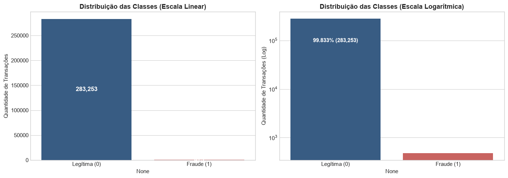
</p>

---

## 2. O Paradoxo da Acurácia e Métricas de Avaliação

Em cenários com **desbalanceamento extremo de classes**, a acurácia convencional é uma **métrica ilusória e perigosa**:

$$\text{Acurácia} = \frac{TP + TN}{TP + TN + FP + FN}$$

> ⚠️ **O Paradoxo da Acurácia:** Se construirmos um modelo ingênuo que classifique 100% das transações como "Legítimas", sua acurácia será de impressionantes **99,83%**. Entretanto, o modelo deixará passar **100% das fraudes** ($\text{Recall} = 0\%$), gerando prejuízo catastrófico para a instituição.

Por essa razão, este projeto estabelece um conjunto rigoroso de métricas focadas na classe minoritária (Fraude = 1):

* **Recall (Sensibilidade / Taxa de Verdadeiros Positivos):** $\frac{TP}{TP + FN}$. É a **métrica prioritária do negócio**, medindo a porcentagem de fraudes reais que o sistema interceptou.
* **Precision (Precisão):** $\frac{TP}{TP + FP}$. Proporção de alertas gerados pelo modelo que são de fato fraudes, mensurando o volume de falsos alarmes.
* **F1-Score:** Média harmônica entre Precisão e Recall: $2 \times \frac{\text{Precision} \times \text{Recall}}{\text{Precision} + \text{Recall}}$.
* **PR-AUC (Precision-Recall AUC / Average Precision):** Área sob a curva Precisão-Recall. É a métrica mais confiável para rankings em dados severamente desbalanceados, pois independe de um limiar fixo e foca exclusivamente na classe positiva.
* **ROC-AUC:** Mede a capacidade geral de discriminação entre as classes em variados limiares.

---

## 3. Engenharia de Atributos e Pré-processamento

Para preparar a base para modelagem preditiva sem vazamento de dados (*data leakage*), foram aplicadas as seguintes etapas:

1. **Higienização de Dados:** Identificação de valores ausentes (0 nulos) e remoção de duplicatas para assegurar a idoneidade da divisão de treino e teste.
2. **Transformação Logarítmica (`log_amount`):** A variável `Amount` exibe distribuição com cauda pesada à direita (muitas compras de baixo valor e algumas compras extremas). Aplicou-se $\log(1 + \text{Amount})$ via `np.log1p` para normalizar a distribuição.
3. **Padronização (`StandardScaler`):** As variáveis contínuas `Time` e `log_amount` foram padronizadas para média 0 e desvio padrão 1, alinhando-se à escala das variáveis PCA (`V1` a `V28`).
4. **Divisão Estratificada (`stratify=y`):** Separação em 80% treino e 20% teste, preservando exatamente a taxa de fraudes de 0,17% em ambos os conjuntos.
5. **Pipelines de Reamostragem Seguros (`ImbPipeline`):** Todas as técnicas de balanceamento artificial (SMOTE e Undersampling) foram encapsuladas via pipeline para operar **estritamente sobre o conjunto de treino**, mantendo o teste 100% puro.

<p align="center">
  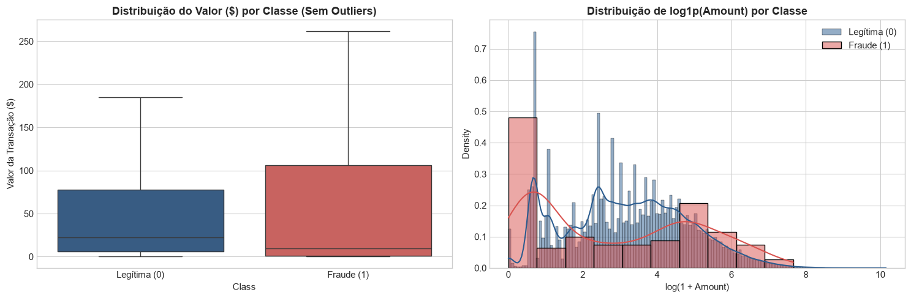
</p>

---

## 4. Comparação de Modelos e Técnicas de Desbalanceamento

Foram implementadas e comparadas 6 abordagens completas:

| Modelo | Estratégia de Desbalanceamento | Recall (Fraude) 🎯 | Precisão (Fraude) | F1-Score (Fraude) | PR-AUC (Avg Prec) 🏆 | ROC-AUC | Falsos Negativos (FN) | Falsos Positivos (FP) |
| :--- | :--- | :---: | :---: | :---: | :---: | :---: | :---: | :---: |
| **Regressão Logística** | Class Weight Balanceado *(Baseline Expert)* | **87,37%** | 5,54% | 10,42% | 0,6770 | 0,9673 | 12 | 1.417 |
| **Regressão Logística** | Undersampling (RandomUnderSampler) | **87,37%** | 5,19% | 9,81% | 0,6195 | 0,9610 | 12 | 1.516 |
| **Regressão Logística** | Oversampling (SMOTE) | **87,37%** | 5,28% | 9,95% | 0,6826 | 0,9674 | 12 | 1.488 |
| **Random Forest** | Class Weight Balanceado | 75,79% | **84,71%** | **80,00%** | 0,7849 | 0,9584 | 23 | 13 |
| **XGBoost** | `scale_pos_weight` calibrado | 78,95% | 72,82% | 75,76% | **0,8077** | **0,9771** | 20 | 28 |
| **Random Forest** | Oversampling (SMOTE via Pipeline) | 77,89% | 70,48% | 74,00% | 0,7922 | 0,9625 | 21 | 31 |

<p align="center">
  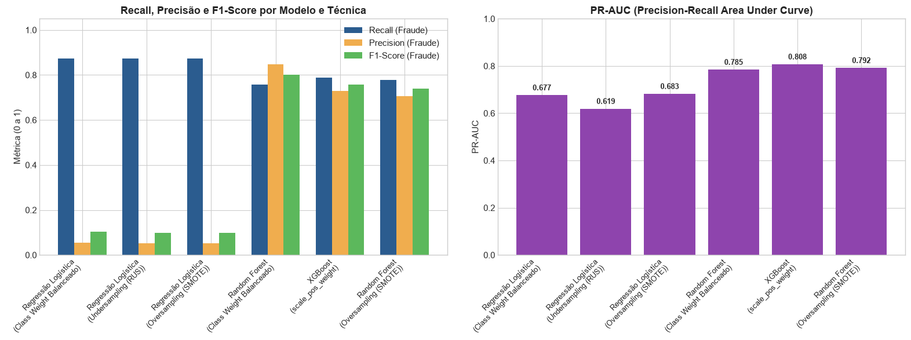
</p>

### Principais Insights da Comparação:
* **Regressão Logística:** Apresentou alto Recall (87,37%), porém à custa de uma precisão extremamente baixa (~5%), gerando mais de **1.400 falsos positivos**. Em produção, isso sobrecarregaria qualquer equipe de operações com alertas improdutivos.
* **Undersampling vs. Oversampling (SMOTE):** O Undersampling puro descartou mais de 99% dos dados legítimos, perdendo variabilidade e registrando o menor PR-AUC (0,6195). O SMOTE recuperou qualidade, mas ainda gerou alto índice de falsos alarmes com modelos lineares.
* **Modelos Ensemble (Random Forest e XGBoost):** Superaram amplamente o baseline linear. O **XGBoost com `scale_pos_weight`** obteve o maior **PR-AUC (0,8077)** e **ROC-AUC (0,9771)**. O **Random Forest com `class_weight='balanced'`** alcançou o maior **F1-Score (80,00%)**, combinando 75,79% de recall com 84,71% de precisão (apenas 13 falsos positivos em mais de 56 mil transações).

<p align="center">
  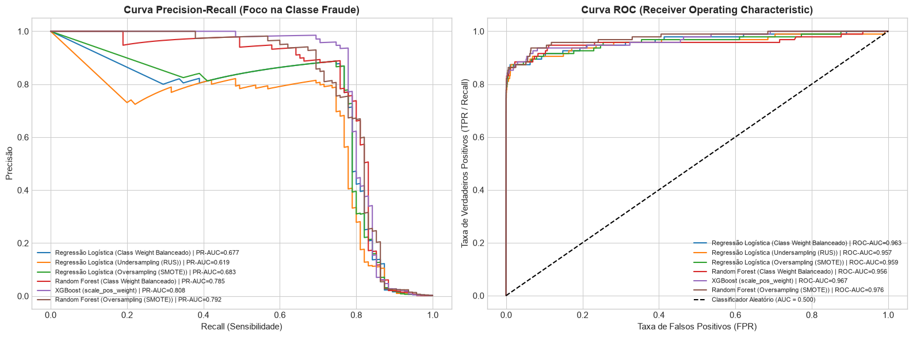
</p>

<p align="center">
  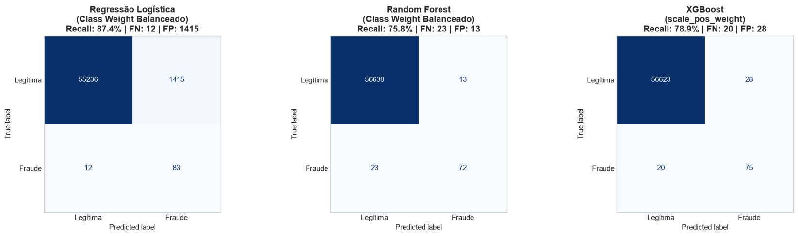
</p>

---

## 5. Ajuste de Limiar de Decisão (Threshold Tuning)

Por padrão, classificadores binários aplicam o limiar $\tau = 0,50$. No entanto, no setor financeiro, esse valor é arbitrário.

Ao analisar a curva contínua de probabilidades do Random Forest, mapeamos o trade-off entre Recall, Precisão e F1-Score ao longo de 100 limiares possíveis (de 0,01 a 0,99):

<p align="center">
  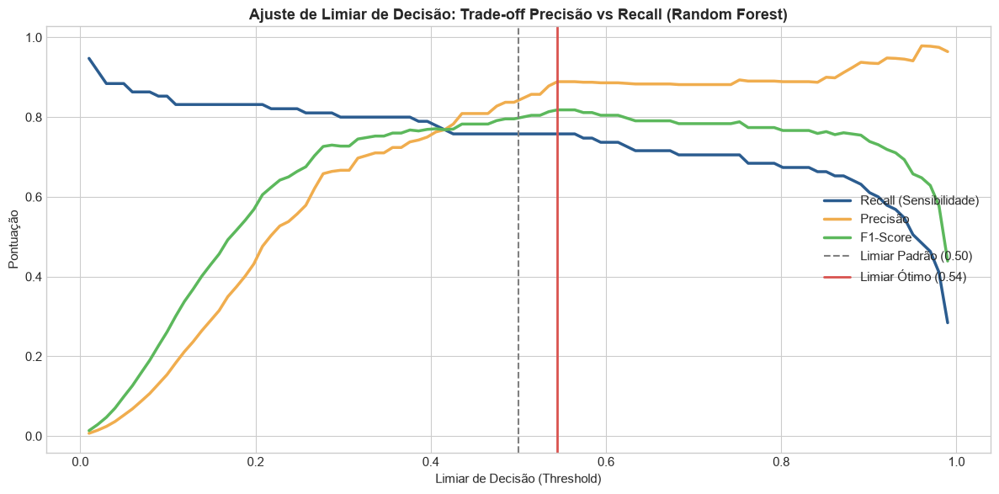
</p>

### Calibração do Limiar:
* **Limiar Padrão (0,50):** Recall: **75,79%** | Precisão: **84,71%** | F1: **80,00%** (23 Falsos Negativos, 13 Falsos Positivos).
* **Limiar Calibrado para o F1 Máximo ($\tau = 0,54$):** Recall: **75,79%** | Precisão: **88,89%** | F1: **81,82%** (redução de falsos positivos para apenas 9).
* **Calibração Agressiva de Prevenção ($\tau = 0,25$ a $0,30$):** Caso o banco queira elevar o Recall para **>85%**, o limiar pode ser reduzido, capturando mais fraudes ao custo de um incremento controlado de contatos preventivos com clientes.

<p align="center">
  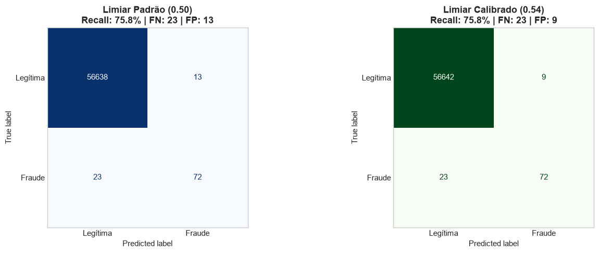
</p>

---

## 6. Explicabilidade com SHAP (Explainable AI - XAI)

Modelos "caixa preta" são proibitivos em ambientes sujeitos a auditoria regulatória (LGPD, normas de compliance do Banco Central). Implementamos o **SHAP (`TreeExplainer`)** para garantir transparência nas decisões.

### 6.1 Visão Global: Variáveis Mais Críticas
As variáveis **`V14`**, **`V4`**, **`V12`**, **`V10`**, **`V17`** e **`V11`** lideram o impacto na pontuação de risco:
* **Valores acentuadamente baixos de `V14`, `V12` e `V10`** (pontos azuis à direita no gráfico Beeswarm) aumentam fortemente a probabilidade de fraude.
* **Valores elevados de `V4` e `V11`** (pontos vermelhos à direita) atuam como fortes catalisadores para a classificação de fraude.

<p align="center">
  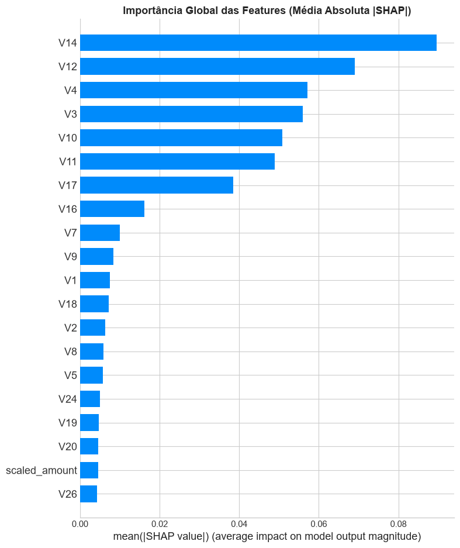
</p>

<p align="center">
  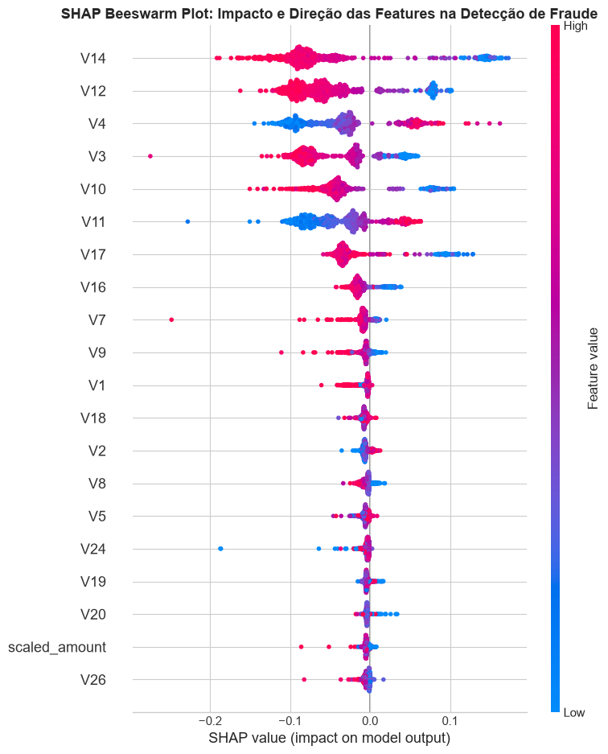
</p>

### 6.2 Visão Local: Explicando Decisões em Transações Reais

Utilizando o **SHAP Waterfall Plot**, conseguimos explicar individualmente o motivo de qualquer transação ter sido classificada como fraude ou legítima:

#### Caso 1: Transação Fraudulenta Detectada
A transação apresentou valores extremos de `V14 = -6.49`, `V12 = -4.57`, `V10 = -4.31` e `V4 = +3.82`, empurrando a probabilidade acumulada de $f(x)$ da média basal (0,05) para próximo de **1,00**.

<p align="center">
  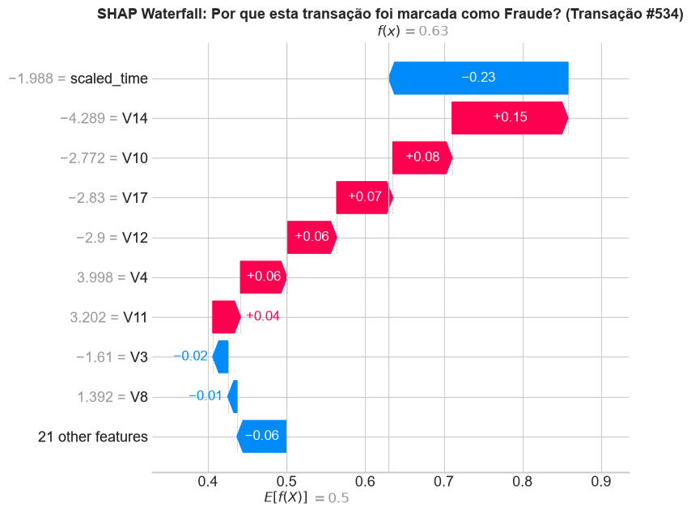
</p>

#### Caso 2: Transação Legítima Confirmada
Valores normais e estáveis de `V14`, `V10` e `V4` mantiveram a contribuição negativa, assegurando que o modelo mantivesse a transação como normal com total segurança.

<p align="center">
  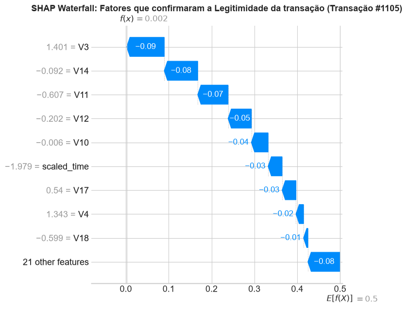
</p>

---

## 7. Diferenciais em Relação ao Baseline da Expert

| Aspecto | Baseline Proposto pela Expert | Implementação Deste Repositório (Diferenciais) |
| :--- | :--- | :--- |
| **Pipeline de Reamostragem** | Sugestão de teste isolado | Implementação com `ImbPipeline` estritamente no treino, eliminando *data leakage* |
| **Técnicas Comparadas** | Regressão Logística básica | 6 configurações integrando Class Weight, RandomUnderSampler, SMOTE, Random Forest e XGBoost |
| **Métrica de Seleção** | ROC e Recall | Foco primário na **Curva Precision-Recall (PR-AUC)**, comprovadamente superior para assimetrias de 0,17% |
| **Threshold Tuning** | Ajuste manual conceitual | Varredura matemática de 100 limiares com curvas contínuas de trade-off de negócio |
| **Explicabilidade (XAI)** | Importância de features genérica | Explicabilidade global (**Beeswarm**) e auditoria individual de transações (**SHAP Waterfall**) |
| **Engenharia de Dados** | Transformações simples | `log1p(Amount)` + `StandardScaler` em pipeline reproduzível e código limpo |

---

## 8. Como Reproduzir Este Projeto

### Pré-requisitos
* Python 3.10 ou superior
* Git

### Passo a Passo

1. **Clone o repositório:**
   ```bash
   git clone https://github.com/SEU_USUARIO/SEU_REPOSITORIO.git
   cd SEU_REPOSITORIO
   ```

2. **Crie e ative o ambiente virtual:**
   * No Windows (PowerShell):
     ```powershell
     python -m venv .venv
     .\.venv\Scripts\Activate.ps1
     ```
   * No Linux / macOS:
     ```bash
     python3 -m venv .venv
     source .venv/bin/activate
     ```

3. **Instale as dependências:**
   ```bash
   pip install --upgrade pip
   pip install -r requirements.txt
   ```

4. **Execute o notebook:**
   ```bash
   jupyter notebook fraude_cartao_credito.ipynb
   ```
   > 💡 O dataset é baixado automaticamente pelo link oficial dentro do notebook, não ocupando espaço no repositório.

---

## 9. Estrutura do Repositório

```plaintext
├── assets/                          # Gráficos e visualizações geradas para documentação
│   ├── comparativo_metricas.png
│   ├── comparativo_threshold.png
│   ├── correlacao_features.png
│   ├── curvas_pr_roc.png
│   ├── distribuicao_amount.png
│   ├── distribuicao_classes.png
│   ├── matrizes_confusao.png
│   ├── shap_beeswarm.png
│   ├── shap_importancia_bar.png
│   ├── shap_waterfall_fraude.png
│   ├── shap_waterfall_legitima.png
│   └── tradeoff_threshold.png
├── fraude_cartao_credito.ipynb     # Notebook Jupyter executado com todas as saídas salvas
├── build_and_run_notebook.py        # Script automatizado de criação e execução do pipeline
├── requirements.txt                 # Dependências e versões exatas dos pacotes
├── .gitignore                       # Ignora ambientes virtuais, CSVs e arquivos temporários
└── README.md                        # Documentação técnica e de negócio completa
```

---

## 👨‍💻 Autor
Desenvolvido por **Daniel** como projeto de portfólio para o bootcamp [Bradesco - Agentes de IA do Zero a Prática](https://www.dio.me/bootcamp/bradesco-agentes-de-ia-do-zero-a-pratica) na plataforma [DIO](https://www.dio.me/).

